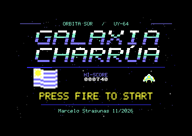
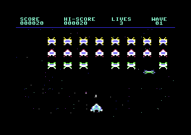

# GALAXIA CHARRÚA

Arcade espacial para Commodore 64 PAL. Mové la nave bajo la escuadrilla, abrí un hueco en sus tres filas y decidí cuándo conviene esperar a que un enemigo rompa la formación. En picada vale el doble, pero también puede embestirte.

[Descargar GALAXIA_CHARRUA.PRG](./GALAXIA_CHARRUA.PRG?raw=true) · [Pruebas de ejecución](pruebas/PRUEBAS.md)




## Jugar en VICE

Usá x64sc con las ROM de un C64 configuradas. Podés abrir el PRG con **File → Autostart disk/tape image** o ejecutarlo desde la terminal.

```sh
x64sc -model c64 -pal -autostartprgmode 1 -autostart GALAXIA_CHARRUA.PRG
```

| Acción | Joystick, puerto 2 | Teclado C64 |
|---|---|---|
| Empezar o volver a jugar | FIRE | Espacio |
| Mover la nave | Izquierda / derecha | A / D |
| Disparar | FIRE | Espacio |

Podés mantener el disparo pulsado. Sólo hay un proyectil propio en vuelo y deben pasar al menos 13 cuadros entre disparos. Para iniciar otra partida, soltá y volvé a pulsar FIRE o espacio. Si esperás unos diez segundos en GAME OVER, vuelve la presentación con el récord.

## Cargar en un C64

Copiá el PRG a un disco o dispositivo compatible. Si lo guardás con el nombre de directorio Commodore `GALAXIA_CHARRUA` en la unidad 8, escribí lo siguiente desde BASIC.

```basic
LOAD"GALAXIA_CHARRUA",8,1
RUN
```

Si hay un solo juego con ese prefijo en el disco, también podés usar `LOAD"GALAXIA*",8,1`. Así evitás escribir el guion bajo en el teclado original. El PRG carga en $0801 e incluye la línea BASIC `10 SYS2061`.

## Puntuación y oleadas

| Enemigo | En formación | En picada |
|---|---:|---:|
| Corona, fila amarilla | 40 | 80 |
| Medusa, fila roja | 30 | 60 |
| Horqueta, fila verde | 20 | 40 |

Cada oleada trae 24 enemigos. Un atacante que pasa de largo vuelve por arriba e intenta recuperar su puesto. Los proyectiles enemigos se desvían hacia el lado en que estaba la nave al disparar. Empezás con tres vidas. Después de un impacto, la nave reaparece en el centro y parpadea durante 90 cuadros. Las marchas y los ataques se hacen más frecuentes hasta la oleada 13. El récord dura mientras siga ejecutándose el programa.

## Compilar

Desde esta carpeta, con ACME en el PATH, ejecutá lo siguiente.

```sh
./build.sh
```

También podés indicar una ruta explícita o generar una tabla de símbolos para el monitor de VICE.

```sh
ACME=/ruta/a/acme ./build.sh -l /tmp/galaxia.sym
```

El script genera `GALAXIA_CHARRUA.PRG` junto al README. ACME incorpora directamente los recursos binarios de `src/`. Para editar y regenerar la ilustración, los sprites o los caracteres enemigos, ejecutá `python3 tools/arte.py` antes de compilar. El dibujo y la música son originales.

## Organización y memoria

| Archivo | Responsabilidad |
|---|---|
| main.asm | Arranque BASIC/6510, IRQ raster y ciclo de cuadros |
| vic.asm, sprites.asm | Banco de video, presentación, estrellas y coordenadas de nueve bits |
| player.asm | CIA1, teclado, movimiento y cadencia |
| enemies.asm | Formación, picadas, retorno y fuego enemigo |
| collisions.asm | Impactos, explosiones e invulnerabilidad |
| game.asm | Partidas, oleadas, BCD y récord |
| sound.asm | Secuenciador de presentación y efectos de tres voces SID |
| data.asm, stars.asm | Tablas, estado y recursos VIC-II |

El VIC-II usa el banco $4000–$7FFF. La pantalla está en $4400, los punteros de sprites en $47F8, el juego de caracteres en $4800, los sprites en $5000 y el bitmap de presentación en $6000. El código empieza en $080D. El PRG ocupa 30.529 bytes, incluidos los espacios entre segmentos.

La formación se dibuja con cuatro caracteres multicolor por enemigo. En partida se usan hasta cinco sprites simultáneos para nave, disparo propio, atacante, disparo enemigo y explosión. El IRQ en la línea 250 avisa al bucle principal una vez por cuadro. El KERNAL salva los registros al entrar y el manejador los restaura antes de RTI. La lógica y el sonido corren en el 6510.
