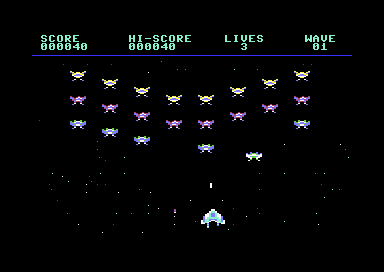

# Verificación del juego y del campo de estrellas

## Bandera, tiro doble y pausa entre vidas

Se probó en x64sc 3.9 PAL el PRG con SHA-256 `855f5a003a7ff2441fdd9996deaee61c95bf886e13cb94f368acad684d07a523`.

- Se dirigieron disparos con el monitor hacia cinco enemigos. El quinto soltó la bandera. Se colocó la nave debajo de su trayectoria y se observó la caída durante 204 cuadros hasta la recogida.
- Manteniendo espacio, se observaron tres salvas dobles simultáneas. Se dirigió el rayo izquierdo de una salva a un enemigo y el derecho a otro. El segundo siguió en vuelo después del primer impacto.
- Se provocó la pérdida de una nave manteniendo FIRE. La formación quedó inmóvil, se borraron los tiros, se perdió X2 y la protección de 90 cuadros permaneció íntegra durante la espera. Soltar y volver a pulsar reanudó la acción. Se comprobó la espera para la tercera vida y GAME OVER al agotarla.
- En una prueba dirigida se eliminaron los 24 puestos y se verificó que X2 sobreviviera al cambio de oleada.
- En una muestra de 72 cuadros con seis rayos activos, la actualización de la partida consumió entre 7.221 y 10.377 ciclos por cuadro. Un cuadro PAL dispone de 19.656 ciclos.

[Bandera](bandera.png) · [Tres salvas dobles](doble.png) · [Pausa entre vidas](vida.png)

## Disparo triple y virajes

La compilación probada con ACME 0.97 y x64sc PAL tiene el SHA-256 `9a9eca2fd052141c509a5fd042db28d0d4e789b2f42d129a14136a77eac1a885`. Con espacio sostenido se observaron los tres sprites de disparo activos a la vez, separados por 13 cuadros. Al liberarse un puesto, el siguiente tiro salió mientras los otros seguían en vuelo. En una prueba dirigida se colocaron los tres proyectiles sobre enemigos distintos en un mismo cuadro. El contador bajó en tres y los tres puestos quedaron libres. También se verificaron cambio de oleada, pérdida de vidas y reinicio.

La captura muestra los cinco ángulos de la nave durante la aceleración, el frenado y la inversión de sentido. Se aplazó el ataque enemigo en esta toma para mostrar la nave sin el parpadeo de invulnerabilidad. [Ver la captura](rafaga.gif)

## Pruebas de la versión anterior

Se regeneraron los gráficos con Python y se ensambló el PRG con ACME 0.97. La segunda compilación reprodujo el SHA-256 `2599e84abe6cfc67890faf63f64153f7434eaadde8b25f936caff3bb7a277f89`. El ejecutable de 30.529 bytes se probó en VICE x64sc 3.9, con un C64 PAL y Xvfb. La prueba en hardware físico sigue pendiente.

| Prueba | Método y resultado |
|---|---|
| Arranque y controles | Autostart del PRG, presentación y comienzo con espacio. Se enviaron A, D y espacio a la ventana de VICE. Se observó desplazamiento y un proyectil en vuelo. En los extremos se leyeron las posiciones 0 y 148 y los bits de X alta correspondientes. Para esta prueba de bordes se prolongó la invulnerabilidad. |
| Continuidad | Con un punto de parada por cuadro en el monitor, se midieron 359 transiciones consecutivas de la primera oleada. En todas, la formación avanzó exactamente un píxel, incluyendo las inversiones de sentido. Aparecieron las seis poses. El GIF toma una captura de VICE cada dos cuadros PAL. |
| Estrellas | Se capturaron 360 cuadros consecutivos de partida y se siguieron puntos de los dos planos en coordenadas de pantalla. Se comprobó el avance por píxel a través de varias filas de caracteres y el cruce del borde inferior. La estrella lenta del extremo derecho ocupó el píxel esperado en 359 de las 360 capturas y en las 152 muestras de la zona inferior. En presentación se siguió un punto durante 330 cuadros, incluido su paso de la derecha a la izquierda de la pantalla. |
| Marciano superior izquierdo | En 360 capturas consecutivas se compararon sus píxeles amarillos contra el gráfico de la pose y la posición del cuadro. La comparación incluyó ocho píxeles de margen a cada lado para detectar imágenes duplicadas. Coincidieron los 360 cuadros. |
| Disparo enemigo | Se verificó en la captura de partida el dardo amarillo con núcleo blanco, de 6 × 11 píxeles. La cola alterna dos poses. |
| Presupuesto de CPU | En una muestra de 60 cuadros, el monitor midió entre 6.496 y 11.344 ciclos desde la lectura de controles hasta la espera de raster. El cuadro del modelo PAL probado tiene 19.656 ciclos. |
| Disparos y colisiones | Hubo bajas con el teclado. Para verificar todos los puestos, se ubicaron proyectiles con el monitor en posiciones de la V y en la picada. Se comprobaron el contador de enemigos, el inicio de la explosión y el incremento del marcador según la fila o el ataque. |
| Oleadas | Al limpiar la formación aparecieron los 24 enemigos de la oleada 2. Se conservaron 740 puntos y aumentó el incremento fraccional de la velocidad. |
| Vidas y reinicio | Una bomba redujo las vidas a dos. El siguiente impacto durante la protección dejó dos vidas. Se prepararon una embestida y un último impacto con el monitor. Se comprobó GAME OVER y, al reiniciar con espacio, oleada 1, tres vidas, puntuación cero y récord de 740. |
| SID | Se renderizó la presentación con reSID y salida WAV. En partida se siguió el índice del secuenciador mientras se disparaba y se observó su avance por nueve posiciones durante la captura animada. |

Para inspeccionar los símbolos, compilá con `./build.sh -l /tmp/galaxia.sym`. En el monitor de VICE, `until` con la dirección de `gameTick` detiene el programa una vez por cuadro de partida. Los bytes `scrollX`, `fineX`, `animation` y `songPos` indican el desplazamiento total en píxeles, su componente fina, la pose y la posición musical.
