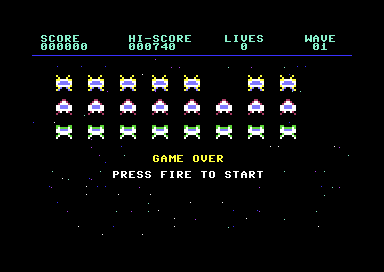

# Pruebas de GALAXIA CHARRÚA

Se ensambló el juego con ACME 0.97 en Debian y se ejecutó en VICE x64sc 3.9 con un C64 PAL, VIC-II 6569R3 y pantalla virtual Xvfb. El alcance de estas pruebas es emulación. La ejecución en una placa C64 física queda pendiente.

**Binario ensayado** · 30.529 bytes · SHA-256 `3429d09d5d9819f3c48f5982358d04d6360d8fe9e0b7ef8d0cef2ab7922345c1`. Una segunda compilación produjo el mismo hash.

## Arranque y controles

- Se inició el PRG con autostart y también se copió con c1541 a una imagen D64 temporal. Con la 1541-II emulada, VICE registró la búsqueda, la carga y el inicio. Se encontró el contador de programa en el bucle de cuadros del juego.
- Desde la presentación se inició una partida con tres vidas y 24 enemigos. Se probaron A, D y espacio mediante eventos de teclado de la ventana. También se asignó un juego de teclas independiente al joystick virtual del puerto 2. FIRE inició la partida y ambos sentidos movieron la nave.
- Con los controles sostenidos se llegó a los dos extremos. El monitor leyó posiciones lógicas 0 y 148 y el bit de X alta del sprite 0 pasó de 0 a 1. Para aislar esta medición se prolongó la invulnerabilidad con el monitor.
- En una partida de desarrollo controlada por teclas, se observaron un disparo en vuelo, bajas con incremento de puntaje, una picada, el regreso por arriba, pérdidas de vidas y GAME OVER. Esta prueba descubrió rótulos mal codificados. Se corrigieron y se revisaron las capturas de la versión final.

## Colisiones y transiciones en el binario final

Se ejecutaron las rutinas del juego en el 6510 emulado. El monitor permitió detener cada cuadro antes de las colisiones y colocar los proyectiles en coordenadas reproducibles. Se leyeron después los contadores, el estado de los enemigos, la duración de la explosión y los tres bytes BCD del marcador.

| Caso | Resultado observado |
|---|---|
| Impactos en las tres filas | Se eliminó el puesto alcanzado y se sumaron 40, 30 o 20 puntos según la fila. |
| Impacto en un atacante | Una horqueta en picada dio 40 puntos. El sprite de explosión quedó activo. |
| Fin de oleada | Entre un disparo con teclado y los impactos dirigidos se despejaron los 24 puestos. La oleada 2 repuso 24 enemigos con 740 puntos acumulados y redujo el período de marcha de 25 a 24 cuadros. |
| Impacto y protección | Una bomba redujo las vidas de 3 a 2. Otra bomba en el cuadro siguiente dejó 2 vidas y 89 cuadros de protección. |
| Embestida y último impacto | Se preparó una colisión con el atacante y luego con una bomba. Se acortó la espera de invulnerabilidad desde el monitor. El juego descontó las vidas restantes y entró en GAME OVER. |
| Nueva partida | Espacio reinició con 3 vidas, 24 enemigos, oleada 1, SCORE 000000 y HI-SCORE 000740. |
| Regreso a presentación | Tras otro GAME OVER, se dejó vencer la espera. La presentación mostró el récord 000740. |

## Video, tiempo y SID

Las tres imágenes de esta carpeta son capturas PNG del monitor de x64sc. En una muestra de 60 cuadros, desde la lectura de controles hasta el regreso a la espera de raster se midieron entre 488 y 8.113 ciclos. Un cuadro PAL de este modelo tiene 19.656 ciclos. La muestra incluye el redibujado de la formación.

Para comprobar la salida de la presentación, se abrió otra instancia con reSID 6581 y salida WAV a 48 kHz. La grabación mono contuvo 480.896 muestras de 16 bits con extremos de −7.114 y +12.519. Esto verifica producción de audio en el emulador. La escucha en un SID físico queda pendiente.

## Repetir una inspección

1. Compilá con `./build.sh -l /tmp/galaxia.sym`.
2. Iniciá `x64sc -model c64 -pal -autostartprgmode 1 -autostart GALAXIA_CHARRUA.PRG`.
3. Entrá en partida y abrí el monitor de VICE. Buscá las direcciones de `hits`, `frameWait`, `shotX`, `shotY`, `alive`, `remaining` y `score` en la tabla de símbolos.
4. Con `until` seguido de la dirección de `hits`, detené el cuadro antes de comprobar impactos. Para un enemigo en formación, el borde izquierdo en unidades lógicas es `4 * (formation + 4 * columna)` y la coordenada Y es `90 + 24 * fila`. Sumá 3 a X y 2 a Y para ubicar un proyectil dentro del enemigo.
5. Escribí las coordenadas en los bytes del proyectil con el comando `>`. Continuá hasta `frameWait` y leé el puesto alcanzado, `remaining` y `score` con `m`. Para volver a jugar normalmente, usá `x`.

